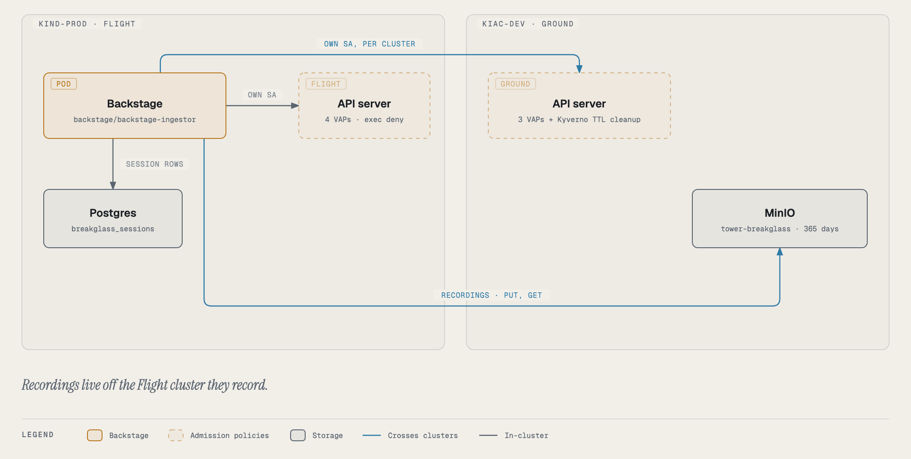

# Break-glass: admin guide

For the people who run the platform: what break-glass is made of, where each piece lives, how to set it up on a
cluster, how to operate it, and why it is built the way it is. If you only use break-glass, the
[user guide](../index.md) is the place to start.

## Start here

| Read | When you want to… |
|---|---|
| [Architecture](#architecture) (below) | see every component and where it runs |
| [Setup](setup.md) | enable break-glass on a cluster, step by step, and verify it |
| [Configuration reference](configuration.md) | look up a config key, an environment variable, a label, a limit or a permission |
| [Admission policies](policies.md) | understand each policy rule on Ground and Flight, and change one safely |
| [Operations runbook](operations.md) | handle a stuck session, a policy outage, a debug image release, an audit request |
| [How it works](internals.md) | follow a session through the backend: states, routes, storage, transport, cleanup |
| [Design decisions](design.md) | know why exec is refused, why VAP on Flight, why one extension, and the build history |
| [Testing and verification](testing.md) | prove a change against the real clusters without touching production |

## Architecture

| Component | Where | What it does |
|---|---|---|
| **Tower UI** (`BreakglassPanel`, `RecordingPlayer`) | jfillman/tower, `src/tabs/topology/` | the Debug panel: form, approvals, terminal (xterm.js over a WebSocket), session list, reviews, player |
| **Break-glass backend** (`breakglass.ts`, `breakglassSpec.ts`, `breakglassStore.ts`) | jfillman/backstage, `packages/backend/src/`, mounted under the glidepath plugin at `/api/glidepath/breakglass` | the routes, the session state machine, the grant and debug-container objects, the terminal relay, the recording, the sweep |
| **Permissions** | backstage `towerPermissions.ts`, `permissionPolicy.ts` | `tower.breakglass.request`, `.approve`, `.terminate` (grant-only), `.self` (grant-only) |
| **Session store** | Backstage's database (glidepath plugin), table `breakglass_sessions` | one row per session: the audit record |
| **Debug RBAC** (per cluster) | gitops-cluster-dev `00-bootstrap/backstage-ingestor-rbac/breakglass-rbac.yaml`; gitops-cluster-kind-prod `30-policy/breakglass/rbac.yaml` | the two debug ClusterRoles and Backstage's standing *binder* right |
| **Ground policies** (kiac-dev) | gitops-cluster-dev `30-policy/kyverno-policies/tower-breakglass.yaml` (+ `-rbac.yaml`) | three Kyverno `ValidatingPolicy` resources compiled into native ValidatingAdmissionPolicies (`vpol-tower-breakglass-*`); Kyverno's cleanup controller deletes expired grants and copy pods |
| **Flight policies** (kind-prod) | gitops-cluster-kind-prod `30-policy/breakglass/policies.yaml` (Argo CD app `tower-breakglass`) | four native ValidatingAdmissionPolicies, including the exec deny |
| **Recordings store** | MinIO on kiac-dev, bucket `tower-breakglass` (`40-observability/minio/create-breakglass-bucket-job.yaml`) | one asciicast per session, 365-day lifecycle; Backstage's key may put and get only |
| **Recordings credentials** | Infisical (`tower-breakglass-minio-access-key`, `-secret-key`) → ExternalSecret `backstage-breakglass-minio` → env `TOWER_BREAKGLASS_MINIO_*` | planted by hand, never generated |
| **Debug image** | jfillman/tower `debug-image/` + `.github/workflows/debug-image.yml` → `ghcr.io/jfillman/tower-debug` | Alpine with the debugging tools; amd64 + arm64; signed with cosign; pinned by digest in three places |

### Identities

Backstage acts on each cluster as its own ServiceAccount, learned at run time with a `SelfSubjectReview` (cached per
cluster), so the grant's subject is always whoever Backstage really is there:

| Cluster | Tier | Backstage's identity |
|---|---|---|
| kiac-dev (`kind-dev` in Backstage's config) | Ground | `system:serviceaccount:backstage-system:backstage-ingestor` |
| kind-prod | Flight | `system:serviceaccount:backstage:backstage-ingestor` |

Both clusters' policies name these usernames literally. A new cluster needs its own (see [Setup](setup.md)).

### What Backstage can do on a cluster

| | At rest | During a session (in that one namespace) |
|---|---|---|
| Create/delete RoleBindings | yes, but only binding `tower-breakglass-debug-live` or `-copy` (RBAC `bind` by resourceNames; the policy narrows it to itself, app namespaces, and a TTL) | same |
| Read pods | as its existing read access allows | `get`, `list` |
| Add an ephemeral container | no | live mode: `pods/ephemeralcontainers` `patch`/`update` (the image and settings checked by policy) |
| Create a pod | no | copy mode: `create` (only a hardened, labelled copy, by policy) |
| Delete a pod | no | yes, but the policy allows only a pod carrying a `debug-*` container or a copy pod |
| Attach | no | `pods/attach` `create` (on Flight, only to a `debug-*` container, by policy) |
| Exec | no | no (on Flight refused by policy even to a session) |

## Ground and Flight, side by side

| | Ground (kiac-dev) | Flight (kind-prod) |
|---|---|---|
| Approval | none | a second person, or glass broken (admins) |
| Policy engine | Kyverno `ValidatingPolicy` → generated VAP | hand-written VAP + bindings |
| Exec deny | not enforced (Tower never offers exec) | `tower-breakglass-no-exec` |
| Approver annotation required | no | yes, or `hangar.io/breakglass-glass-broken: "true"` |
| TTL backstop | Kyverno cleanup controller | **not yet** (slim Kyverno on kind-prod in progress); Backstage's sweep only |
| Image signature checked at admission | no (digest only) | no (digest only); planned with the slim Kyverno |
| Last ready pod recycled | if the requester asked | never |

Known gaps and their planned fixes are tracked in the platform's break-glass gaps spec; the user-facing ones are listed
in [Guardrails](../guardrails.md#what-break-glass-does-not-protect-against).
