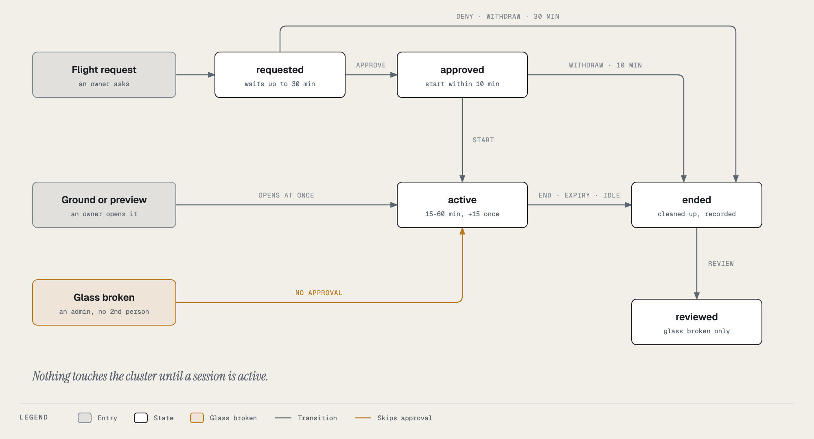
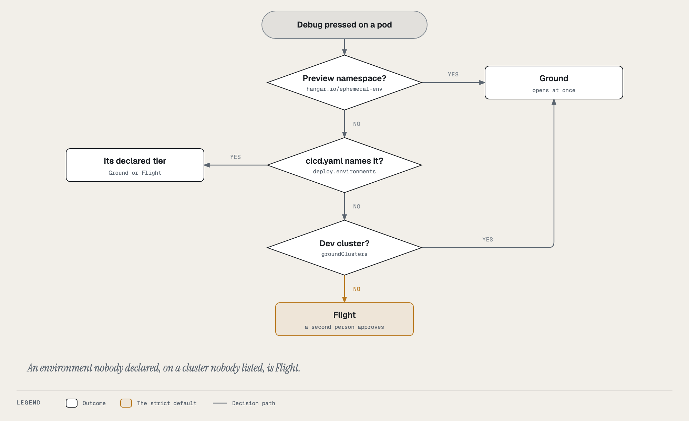

# How it works

A session from the backend's point of view: its states, the routes that move it, what is stored, how the terminal
travels, and what happens at the end. Code: backstage `packages/backend/src/breakglass.ts` (routes, lifecycle,
terminal), `breakglassSpec.ts` (the Kubernetes objects and the recording format), `breakglassStore.ts` (the table).

## States

| State | Entered by | Left by | Deadline (`expires_at`) |
|---|---|---|---|
| `requested` | a Flight `POST /sessions` | approve → `approved`; deny, withdraw, cancel, expiry → `ended` | request + 30 min |
| `approved` | `POST /sessions/:id/approve` | start → `active`; withdraw, expiry → `ended` | approval + 10 min |
| `active` | a Ground or glass-broken `POST /sessions`, or `POST /sessions/:id/start` | any end reason → `ended` | start + duration (+15 once) |
| `ended` | `end()` | never | n/a |

Every transition is a conditional `UPDATE … WHERE state = <from>` (`claimTransition`, `claimEnd`, `claimExtension`,
`claimReview`). A lost race returns false and the route answers 409, so two approvers, two ends or two reviews can
never both win.

A glass-broken session also has `review_state`: `due` from insert, `done` after `claimReview` (only from `ended`).

## Routes

Mounted at `/api/glidepath/breakglass`. Every route authenticates the user (no service tokens) and authorizes against
the app's catalog entity.

| Route | Permission | Does |
|---|---|---|
| `POST /sessions` | `request` (`self` when `glassBroken` on Flight) | validates; derives the tier; checks the target; Ground and glass broken → activate; Flight → store `requested`, notify approvers |
| `GET /sessions?app=&env=` | `request` | the environment's newest 50 sessions, plus `user`, `recordingsConfigured`, `recordingRetentionDays`, `canBreakGlass`, `canReview`, `canTerminate` |
| `GET /sessions/:id` | `request` | one session (a deep link past the list's window), with the same `user` and capabilities |
| `GET /queue` | signed in | what the caller can act on across every app: `toApprove` (someone else's `requested`, on an app they may `approve`), `toStart` (their own `approved`), `toReview` (someone else's ended glass-broken `due`, same check; `overdue` after 72 h). One batched permission check for all apps |
| `POST /sessions/:id/approve` · `/deny` | `approve` | not the requester; must be `requested` and unexpired; optional `note` |
| `POST /sessions/:id/start` | `request` | requester only; must be `approved` within its window → activate |
| `POST /sessions/:id/extend` | `request` | requester only; `active`; once |
| `POST /sessions/:id/end` | own session, its approver, or `terminate` | `requested`/`approved` → withdrawn/cancelled; `active` → ended by user / terminated |
| `POST /sessions/:id/review` | `approve` | glass broken, `ended`, `due`, not the requester; `note` required |
| `GET /sessions/:id/recording[?purpose=play]` | `request` | streams the `.cast` from the store; audited; 410 past retention |
| WebSocket `…/sessions/:id/attach` | the session's requester | the terminal (below) |

Notifications link to the session: `/tower?entity=<ref>&tab=topology&env=<env>&breakglass=<id>`; Tower opens the
environment's Pods stage on it (`breakglassDeepLink.ts`).

Request validation (`parseSessionRequest`): names are plain (`[A-Za-z0-9._-]`), `mode` is `copy` or `live`,
`durationMinutes` is 15/30/60, `reason` is non-empty and ≤ 2000 characters, `ticketUrl` is `http(s)` and ≤ 500, process
access only with `live`, `recycleLastPod` only with `live` (and dropped on Flight).

## Deciding the tier

`tierFor({ preview, declared, cluster, groundClusters })`, pure and unit-tested:

1. `preview`: the namespace (read from the cluster) has `hangar.io/ephemeral-env: "true"` → Ground. An unreadable
   namespace is never treated as a preview.
2. `declared`: the release plan built from the app's `cicd.yaml` lists the environment as Ground or Flight.
3. Otherwise the cluster: in `glidepath.breakglass.groundClusters` → Ground; anything else (including a cluster added
   later and not yet listed) → Flight, the stricter one.

## Opening a session (`activate`)

1. Register the session's runtime in memory, **then** store or claim the row as `active`, **then** touch the cluster.
   A crash in between leaves a row the next process's sweep ends and cleans up.
2. Re-check the target: the namespace's `hangar.io/app` and `hangar.io/env` labels name this app and environment; the
   pod is `Running`; the container exists. (An approved request may be minutes old.)
3. Volume access: compute the mounts (`podVolumeMounts`) and store the list on the row.
4. Create RoleBinding `tower-breakglass-<id>` binding the mode's debug role to Backstage's own identity on that
   cluster (a `SelfSubjectReview`, cached), with the TTL label and the requester, approver (or glass-broken) and expiry
   annotations.
5. Live: re-read the pod and `replaceNamespacedPodEphemeralcontainers` with the debug container appended. Copy: create
   the copy pod. Both retry a 403 for up to 5 s (`withGrant`), because a new RoleBinding takes a moment to apply.
6. Wait up to 120 s for the debug container to be `running`; fail fast on an image pull or config error.

Any failure ends the session (`failed to start: …`) and runs the normal cleanup, so a half-opened session leaves
nothing behind.

## The terminal

- **Transport.** A WebSocket on the Node server's `upgrade` event, the pattern Backstage's own Signals backend uses.
  Backstage's new backend system gives plugins no upgrade hook, so the glidepath router subscribes to the server's
  `upgrade` event on the first ordinary request it sees (Tower always lists sessions before opening a terminal).
- **Authentication.** A browser cannot set `Authorization` on a WebSocket, so the user's Backstage token comes as the
  `Sec-WebSocket-Protocol` value and is verified like any token. Then: 401 without a valid user token; 403 if the user
  is not the session's requester; 410 if the session is not active, not in this process, or past its deadline.
- **Relay.** The backend attaches to the debug container (`client-node` `Attach`, TTY) and relays bytes:

  | Direction | Frame | Content |
  |---|---|---|
  | browser → backend | text JSON | `{type:"input", data}` (≤ 64 KiB) or `{type:"resize", cols, rows}` (clamped 10-500 × 5-300) |
  | backend → browser | binary | terminal output |
  | backend → browser | text JSON | `attached`, `extended`, `detached` (with a reason), `ended` (with a reason), `error` |

- **Reconnect.** A second WebSocket for the same session replaces the first (`opened in another tab`). When the
  Kubernetes stream closes, the backend reads the debug container's state for up to 15 s (`settleDebugState`): the
  kubelet reports an `exit` a moment after the stream closes. Terminated → the session ends (*shell exited*); still
  running → the browser is told to reconnect; pod deleted → *pod is gone*. Attaching to an exited container is refused
  up front, because the API server would answer 500.

## Recording

`CastRecorder` writes asciicast v2: a header (`width`, `height`, `timestamp`, `title`, `env`) and one
`[seconds, kind, data]` line per event, `o` output (UTF-8 decoded across chunk boundaries), `i` input, `r` resize
(`COLSxROWS`). `activate()` writes the recording's header to the store **before** the RoleBinding: if that fails, the
session is refused with 503 (*recordings are unavailable*) and nothing reaches the cluster. The sweep saves a checkpoint
every 10 s when there are new events; `end()` saves the final version and stores the key, bucket, S3 version, SHA-256
and size on the row. The object key is `<app>/<env>/<id>.cast`, content type `application/x-asciicast`, with the
SHA-256 also in the object's metadata; in the object-locked bucket each checkpoint is a new version. A session that
ends after a backend restart takes the last checkpoint, hashing it on the way.

**The anchor** (`breakglassAnchor.ts`): after the final upload, `anchor()` signs the recording's bytes with the anchor
key (ECDSA-SHA256, DER) and submits a Rekor `hashedrekord` (hash, signature, public key); the row keeps
`recording_rekor_index` and `_uuid`. A failure (or no key) is noted in `anchor_error` with `anchor_attempted_at`; the
sweep's `anchorAction(row, now)` (pure) retries every 5 minutes for 24 hours after the end, reading the object back by
bucket and version and checking its hash against the row's before signing. Rekor's 409 (entry exists) is read back
from its `Location`.

## The sweep

Every 15 s, for every unfinished row, `sweepAction(session, runtime, now)` (pure, unit-tested) returns one of:

| Situation | Action |
|---|---|
| `requested`, past its deadline | end: *request expired before anyone approved it* (and notify the requester) |
| `approved`, past its deadline | end: *approved but not started within 10 minutes* (and notify) |
| `active`, past its deadline | end: *expired* |
| `active`, no runtime in this process | end: *backend restarted during the session* |
| `active`, no terminal for > 2 min | end: *terminal closed and not reopened within 2 minutes* |
| `active`, no input or output for > 10 min | end: *idle for 10 minutes* |

Then, for ended rows with a recording and no anchor (ended < 24 h ago): `anchorAction` → re-read and anchor.
| `active`, new events, last save > 60 s ago | checkpoint |

Each active session also has its own timer for its deadline, so the hard stop does not wait for the sweep.

## Ending (`end`)

`end(id, reason)` is idempotent: only the caller whose `claimEnd` moves the row to `ended` does the cleanup. A row that
never opened (`requested`, `approved`) has nothing in the cluster: it is audited and that is all. For an opened one,
in this order (the grant is still there for steps 1 and 2):

1. Close the terminal and the Kubernetes stream.
2. **Copy mode:** delete the copy pod (grace period 0).
3. **Live mode:** recycle. If the pod has no `debug-*` ephemeral container, leave it. If it is the last ready pod and
   the requester did not ask (never on Flight), skip and notify. Otherwise delete it through Argo CD (the app's
   Application must own it), and if that fails (a pod Argo CD does not manage), delete it directly; the
   `tower-breakglass-pod-delete` policy allows only that.
4. Delete the RoleBinding.
5. Save the recording, or take the last checkpoint.
6. Store the outcome (`recycled`, the recording's key, hash and size, and any **notes**) and audit it: a failed audit
   event if there are notes, so the trail shows a partial cleanup.
7. Glass broken and still due: notify the reviewers.

## Storage

Table `breakglass_sessions` in the glidepath plugin's database, created on first use; later columns are added with
`hasColumn` checks, so an older table upgrades in place.

| Column | Meaning |
|---|---|
| `id` | session id (12 base-36 characters), primary key |
| `app`, `env`, `cluster`, `namespace`, `pod`, `container` | the target |
| `mode`, `process_access`, `volume_access`, `volumes` (JSON) | what was asked for, and the volumes mounted |
| `recycle_last_pod`, `recycled` | live mode's restart: asked, and done |
| `reason`, `ticket_url` | the requester's justification |
| `requester`, `tier`, `duration_minutes` | who, Ground/Flight, length |
| `approver`, `approved_at`, `decision_note` | the second person (approve or deny) |
| `glass_broken`, `review_state`, `reviewed_by`, `reviewed_at`, `review_note` | phase 4 |
| `created_at`, `started_at`, `extended_at`, `expires_at`, `ended_at` | times; `expires_at` is the current state's deadline |
| `end_reason`, `ended_by` | how it ended |
| `role_binding`, `copy_pod`, `debug_container` | the cluster objects' names |
| `recording_key`, `recording_sha256`, `recording_bytes` | the recording |
| `recording_bucket`, `recording_version` | where it is and which version the hash names (phase B; older rows have neither and read from `legacyBucket`) |
| `recording_rekor_index`, `recording_rekor_uuid`, `anchor_attempted_at`, `anchor_error` | the Rekor anchor, or why the last attempt failed |
| `cleanup_notes` | what could not be cleaned up, or why something was skipped |
| `state` | `requested` / `approved` / `active` / `ended` (indexed, as is `app, env`) |

Rows are never deleted: they are the audit record. A recording's availability follows the bucket's lifecycle.
