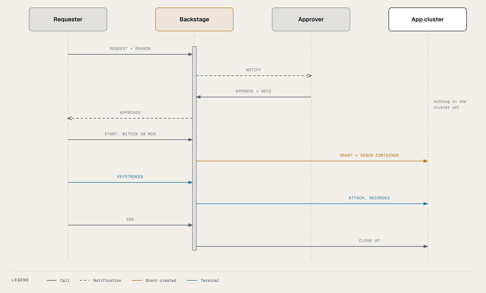
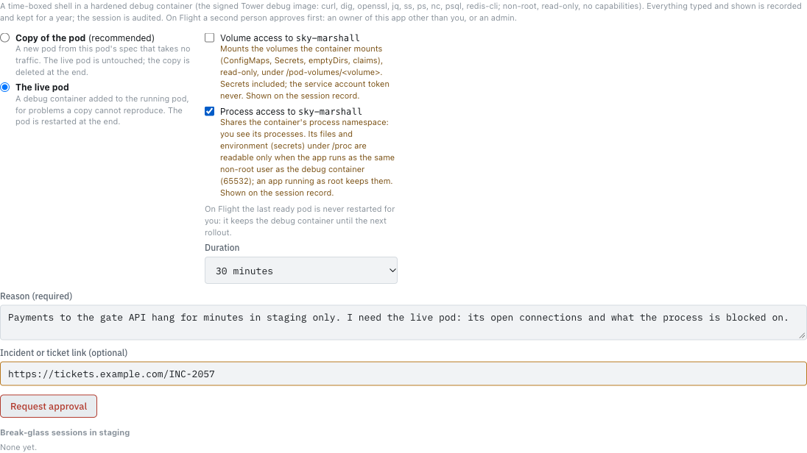
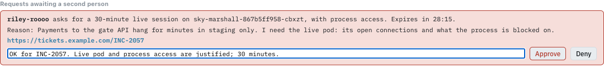

# Walkthrough: a Flight session

On **Flight** (staging, production) a session needs **two people**: you ask, someone else approves, then you start
it. Nothing touches the cluster until you press Start. This page follows both sides.

**Who can approve:** an owner of the app (a member of its owning team) **other than you**, or an admin. Tower refuses
your own approval, and so does the cluster: on Flight the grant must name an approver who is not the requester.

## The requester: ask

1. Find the pod and press **Debug** (Topology → the environment → Pods → the pod), exactly as on
   [Ground](ground-walkthrough.md#1-find-the-pod).
2. Fill in the form. It is the same form, with two differences:
   - the panel tells you a second person approves first;
   - there is no "restart even if it is the only ready one": on Flight the last ready pod is never restarted for you.
3. Write a **reason** an approver can judge without asking you, and add the **incident link** if there is one. The
   approver sees exactly what you ask for: mode, process access, volume access, duration, reason, link.
4. Press **Request approval**.

The panel now shows that you are waiting, for whom, and when the request expires (30 minutes). **Withdraw** cancels
it.

The app's owners (except you) and the admins get a **high**-severity notification, *Break-glass request on <app>
<env>: approval needed*, with your reason and a link to the environment in Tower.

## The approver: decide

1. Open the notification's link (it opens the request), or go to the environment in Topology: the **Break-glass**
   card under Pods (and any pod's Debug panel) shows it. The **Break-glass** strip on the Tower home page lists every
   request you can decide, across apps.
2. Under **Requests awaiting a second person** you see each request: who, the mode and options, the pod, the
   duration, the reason, the ticket link, and the time left.
3. Judge it the way you would judge a production change:
   - Is the reason specific? Could a log line, a metric or the Topology tab answer it instead?
   - Is the mode the least intrusive that works? A copy before the live pod; process or volume access only if the
     reason needs it.
   - Is the duration sensible?
4. Optionally write a **note** (it goes on the record and to the requester), then **Approve** or **Deny**.

Only one decision counts: if two people decide at once, the second is told it was already decided. A request that
has expired cannot be approved.

## The requester: start

The requester gets a notification (*approved* or *denied*, with the note; its link opens the session). After an
approval the pod's Debug panel, the Break-glass card and the home page's strip show who approved it and the
**10 minutes** you have to start:

Press **Start recorded session**. Only now does Backstage grant itself the debug role in the namespace (the grant
names you and the approver), add the debug container, and start the recording. The session's 15, 30 or 60 minutes
start now, not at approval.

From here it is the same as Ground: the red banner, the countdown, **Extend +15 min** (once, no second approval), and
**End session**. See [Inside the session](in-the-session.md).

## Ending on Flight

- **Who can end it:** you (**End session**), the approver, or an admin: on the environment's **Break-glass** card
  under Pods, **End** on your session, with a confirm naming you (recorded as *terminated by …*).
- **Live mode:** the pod is restarted through Argo CD when you end, **unless it is the last ready pod** of its
  Deployment or Rollout. Then it keeps the debug container until the next rollout, and you are notified to restart it
  from Tower when that is safe.
- **Copy mode:** the copy is deleted; the live pods were never touched.

## When no one can approve in time

If production is down and no other owner or admin can be reached, an admin can
[break the glass](glass-broken.md): start a Flight session at once with no second person. Everyone is told
immediately, and the session must be reviewed afterwards.

## Timings at a glance

| Step | Limit | What happens at the limit |
|---|---|---|
| Waiting for approval | 30 minutes | The request ends: *request expired before anyone approved it*. You are notified. |
| Approved, not started | 10 minutes | The approval lapses: *approved but not started within 10 minutes*. Request again. |
| The session | 15, 30 or 60 minutes, +15 once | The session ends: *expired*. |
| No input or output | 10 minutes | The session ends: *idle for 10 minutes*. |
| Terminal closed | 2 minutes | The session ends: *terminal closed and not reopened within 2 minutes*. |
