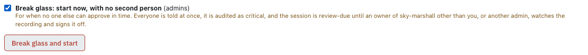
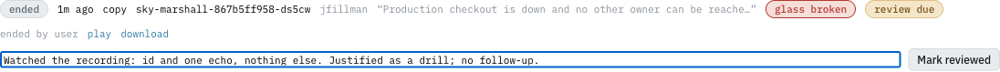

# Breaking the glass, and reviews

The two-person rule is the main protection on Flight. **Breaking the glass** is the one way around it, for when
production is down and nobody else who could approve can be reached in time. It is deliberately loud, and it is checked
afterwards.

## Who can, and where

- **Admins only** (members of `group:default/admins`, through the grant-only permission `tower.breakglass.self`).
  Owning the app is not enough.
- **Flight only.** On Ground there is no second person to skip, so the option does not appear (and the backend ignores
  it).

## How to break the glass

1. Open the pod's **Debug** panel and fill in the form as for any Flight request. Write the reason for the record:
   what is broken, and why it cannot wait for an approver.
2. Tick **Break glass: start now, with no second person**. The warning under it says what follows.
3. Press **Break glass and start**.

The session opens at once. Its banner says **Glass broken: no second person, review due** for the whole session.
Everything else (the debug container, the limits, the recording, the cleanup) is the same as any Flight session.

## What happens because you did

| When | What |
|---|---|
| Before anything is created | **Everyone** gets a *critical* notification: *Glass broken on <app> <env>*, with who, which pod, the mode, the reason and the link. It goes out even if the session then fails to open. |
| In the audit log | The request is audited **critical**, and so is its end. |
| In the cluster | The grant (RoleBinding) is marked `hangar.io/breakglass-glass-broken: "true"` and names no approver. Flight's admission policy accepts exactly that, or a distinct approver, never both and never neither. |
| On the session record | **glass broken** and **review due**, from the moment it opens. A session that fails to start, or whose backend dies, still needs its review. |
| When it ends | The app's owners and the admins, except you, get *Break-glass review due on <app> <env>*, with the end reason and a link. |

## Reviewing a glass-broken session

**Who can review:** anyone who could have approved it: an owner of the app other than the person who broke the glass,
or another admin. **Never the person who broke it.**

**When:** after the session has ended. Reviewing a live session is refused.

1. Open the notification's link (it opens the session), or the environment's **Break-glass** card under Pods in
   Topology. The **Break-glass** strip on the Tower home page lists every review you can do, across apps, and marks one
   **overdue** after 72 hours. The session shows **glass broken** and **review due**.
2. Press **play** and watch the recording (see [Recordings](recordings.md)). Check that the player says
   *SHA-256 matches the session record*.
3. Decide: was breaking the glass justified, and did the session stay within its reason?
4. Write the review note (required): what the recording shows and whether it was justified. Then press
   **Mark reviewed**.

The review happens once. The record then shows **reviewed by <you>**, with your note and the time (hover it), and the
person who broke the glass is notified with your note. Reviewing is audited (*high*).

If the review finds a problem, the note is the start, not the end: raise it the way your team raises any production
incident.

**Reminders and escalation.** A day after the session ends with no review, the eligible reviewers are reminded. At
three days it is escalated: a *critical* notification to the admins and the reviewers group, and the queue on the Tower
home page marks it **overdue**. Each happens once.

**When no one else can review.** Reviewing is for the app's owners other than the person who broke the glass, the
admins, and the members of a **fallback reviewers group** (`glidepath.breakglass.reviewers`, by default the admins;
this platform names `breakglass-reviewers`). Fallback reviewers may review, never approve or start. If all of those
hold nobody but the requester, the session says **no one else can review this**: an admin names a group with a second
person in it.

## What breaking the glass does not change

- The session is still recorded, time-boxed, idle-limited and cleaned up.
- The debug container is still hardened, and the cluster still checks it.
- Exec is still refused.
- The last ready pod is still never restarted for you.
