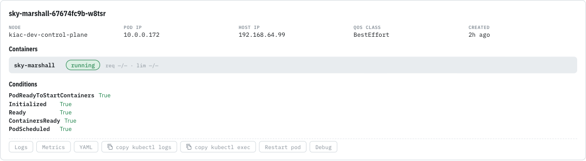
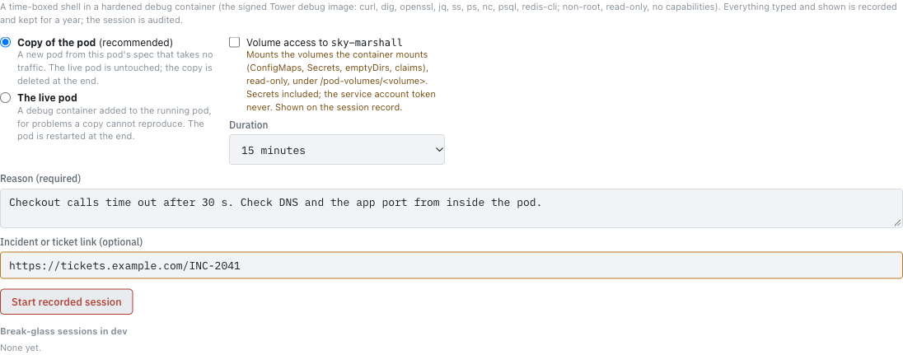
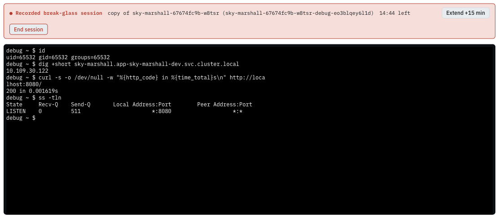
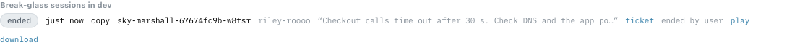

# Walkthrough: a Ground session

This walks through debugging a pod in a **Ground** environment (dev, or a PR preview). Ground sessions open at once:
no approval, but the same recording, time limit and cleanup as everywhere else.

**You need:** to be an owner of the app (a member of the team in its catalog `spec.owner`), and a running pod.

## 1. Find the pod

1. Open the app in **Tower** and go to the **Topology** tab.
2. Pick the environment.
3. Open **Pods** and choose the pod you want to look at.
4. In the pod's action row (Logs, Metrics, YAML, …) press **Debug**.



The Debug panel opens under the pod. Its form is the same on Ground and Flight. At the bottom is the list of
break-glass sessions in this environment, yours and everyone else's (the same list is the **Break-glass** card under
Pods, which is where you find a session once its pod is gone).

## 2. Fill in the form



| Field | What to choose |
|---|---|
| **Copy of the pod** / **The live pod** | Start with the copy. It is a new pod built from this pod's spec that takes no traffic; the live pod is untouched. Choose the live pod only for a problem a copy cannot reproduce (a hung connection, state held in memory). See [Choosing a mode](options.md). |
| **Volume access to *container*** | Tick it to read the files the app container mounts (ConfigMaps, Secrets, claims), read-only, under `/pod-volumes/<volume>`. Shown on the session record. |
| **Process access to *container*** (live pod only) | Tick it to see the app's processes. Shown on the session record. |
| **Restart the pod at the end even if it is the only ready one** (live pod only) | Live mode always restarts the pod when you end, because the debug container stays in it otherwise. If this pod is the only ready one, Tower leaves it alone unless you tick this, accepting a moment of downtime. |
| **Container** | Shown only when the pod has more than one container: the one you are investigating. |
| **Duration** | 15, 30 or 60 minutes. You can add 15 minutes once, later, without asking anyone. |
| **Reason (required)** | What you are looking for. It goes on the record and in the audit log. |
| **Incident or ticket link (optional)** | An `http(s)` link to the incident or ticket. Shown prominently on the record. |

Press **Start recorded session**. Preparing the debug container takes a few seconds, at most two minutes (the image
is pulled the first time on a node).

## 3. Work in the session



The red banner stays on screen for the whole session. It shows:

- **● Recorded break-glass session**: everything you type and everything printed is being recorded;
- the mode (*copy of …* or *live: debug container in …*) and any options you chose;
- the countdown to the hard stop;
- **Extend +15 min**: your one free extension (it disappears once used, and the countdown says *(extended)*);
- **End session**.

The terminal is a real shell (`sh`) in the debug container, as user 65532. The [Inside the session](in-the-session.md)
page lists the tools and what you can and cannot do. The session above, in copy mode on sky-marshall's dev pod:

```text
debug ~ $ id
uid=65532 gid=65532 groups=65532
debug ~ $ dig +short sky-marshall.app-sky-marshall-dev.svc.cluster.local
10.109.30.122
debug ~ $ curl -s -o /dev/null -w "%{http_code} in %{time_total}s\n" http://localhost:8080/
200 in 0.001619s
debug ~ $ ss -tln
State     Recv-Q    Send-Q       Local Address:Port        Peer Address:Port
LISTEN    0         511                      *:8080                   *:*
```

`localhost:8080` answers because the copy runs the app's own container beside the debug container.

If the terminal disconnects (a network blip, closing the tab), you have **2 minutes** to come back: **Reconnect** in the
panel, or **Reopen terminal** on the pod's Debug panel or the Break-glass card. After that, the session ends.

## 4. End the session

Press **End session** (or type `exit`). Tower then, in order:

1. deletes the copy pod (copy mode);
2. restarts the live pod (live mode) through Argo CD, or deletes it directly if Argo CD does not manage it; a last ready
   pod is left alone unless you ticked the box, and you get a notification saying so;
3. removes the temporary permission it gave itself;
4. stores the recording and its SHA-256.

The session moves to **ended** in the list, with what happened: the end reason, whether the pod was restarted, any
notes, and a **play** and **download** link for the recording.



Sessions also end on their own: at the end of their time, after **10 minutes** with no input or output, when the
shell exits, or if the pod disappears. The panel says why.

## What if…

| Situation | What happens |
|---|---|
| You already have a session or request open somewhere | The Start button is disabled and the panel says where. One at a time, across all apps. |
| You close the browser | The session waits 2 minutes for you, then ends and cleans up. |
| Backstage restarts during your session | The session ends; the recording is what was saved at the last one-minute checkpoint. |
| The pod is replaced during the session (a rollout) | Copy mode is unaffected. Live mode ends with *pod is gone*. |
| The debug container cannot start (for example the image cannot be pulled) | The start fails with the reason, and nothing is left behind. |

Next: [Walkthrough: a Flight session](flight-walkthrough.md).
