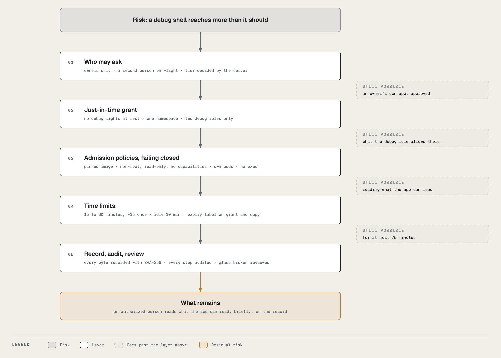

# Guardrails

A shell inside a production pod is the most powerful thing Tower offers, so it is guarded in layers. No single layer
is trusted: each one assumes the one before it might fail. This page lists every layer, what it checks, and what it
stops.

## The layers

| # | Layer | Where it runs | What it enforces |
|---|---|---|---|
| 1 | **Tower** | your browser | shows only what you may do, and why the rest is greyed out. A convenience, never trusted: every route checks again. |
| 2 | **Permissions** | Backstage's permission framework | only the app's owners may request; only owners and admins may approve; only admins may break the glass; only admins and the session's approver may end someone else's session. Anyone else gets a 403. |
| 3 | **Backend rules** | Backstage's backend | the tier comes from the server, never the request; you cannot approve or review your own; one open session per person; the namespace must belong to that app and environment (its labels, read from the cluster); the pod must be running; durations are 15, 30 or 60; recordings must be configured. |
| 4 | **Just-in-time permission** | Kubernetes RBAC | Backstage holds **no debug rights at rest**. For each session it creates a RoleBinding granting itself one of two debug roles in that one namespace, and deletes it at the end. Its only standing right is to create those bindings, for those two roles. |
| 5 | **Admission policies** | the Kubernetes API server, failing closed | the grant's shape (name, role, subject, namespace, expiry; on Flight a named approver who is not the requester, or the glass-broken mark); the debug container's image digest and every security setting; which pods Backstage may delete; on Flight, no exec for anyone but operators, and attach only to a debug container. |
| 6 | **Expiry** | Backstage's timers, and the cluster | the session's hard stop, the 10-minute idle limit, the 2-minute disconnect limit; and an expiry label on the grant and the copy pod that the cluster acts on even if Backstage is gone (Ground today; Flight is being added). |
| 7 | **Record and review** | the audit log, the recording store | every request, decision, start, extension, end, play and download is audited; every byte is recorded with a SHA-256; a glass-broken session must be reviewed by someone else. |

## What each layer stops

| If someone… | It is stopped by |
|---|---|
| who does not own the app asks for a session | layer 2 (403) |
| approves their own Flight request | layer 3 (403), and layer 5 refuses a grant whose approver is the requester |
| sends a crafted request saying a production environment is Ground | layer 3: the tier is read from `cicd.yaml` and the cluster, never the request |
| points a request at another app's namespace | layer 3: the namespace's own `hangar.io/app` and `hangar.io/env` labels must match |
| gets Backstage to bind a broader role (`edit`, `cluster-admin`) | layer 4: Backstage may `bind` only the two debug roles; Kubernetes' own escalation check refuses anything else; layer 5 refuses any other role, subject or namespace |
| runs a different image, or the debug image as root, privileged, writable or with capabilities | layer 5: the exact image digest, non-root user and non-zero group, read-only root, no privilege escalation, all capabilities dropped, read-only volume mounts |
| mounts a host path or the app's Kubernetes token | the backend never mounts them, and the copy's debug container gets an empty volume over the token path |
| uses a session's grant to delete other pods | layer 5: Backstage may delete only a pod carrying a debug container, or a copy pod |
| uses `kubectl exec` on Flight instead | layer 5: exec into app namespaces is refused to everyone but platform operators |
| leaves a session running | layer 6: hard stop, idle limit, disconnect limit, and the expiry label |
| breaks the glass to skip the second person | it works, by design, and layer 7 makes it loud: everyone is told, it is audited critical, and it must be reviewed |
| replaces a recording afterwards | layer 7: the player shows the SHA-256 no longer matches the record |

## Failing closed

Every admission policy fails closed: if the API server cannot evaluate a rule, the request is refused. Break-glass is
then **unavailable, never unguarded**. All of them are native ValidatingAdmissionPolicies, enforced inside the API
server itself, so they do not depend on a separate policy engine staying up. Each rule is scoped to break-glass objects
only, so a policy problem can never affect anything else in the cluster.

## What break-glass does not protect against

Knowing the limits is part of using it safely.

- **You can read what the app can read.** With volume access you see every key of every Secret the container mounts;
  with process access you may read the app's environment (see [Options](options.md#process-access-live-pod-only)). The
  recording then contains whatever you displayed, for a year, readable by the app's owners.
- **What you type is recorded.** Don't paste credentials into the terminal.
- **A copy pod runs the app.** Background work (queue consumers, schedulers) runs in the copy too.
- **A recording is only as safe as its store.** The SHA-256 check detects a replaced recording; the store itself does
  not yet prevent replacement (planned: a locked bucket and a transparency-log anchor).
- **Breaking the glass relies on the review.** It is the weakest link by design, so it is the most visible one.

For the full permission table across all of Tower, see the [Security model](../security.md). For how the policies are
written and deployed, see the [admin guide](admin/policies.md).
