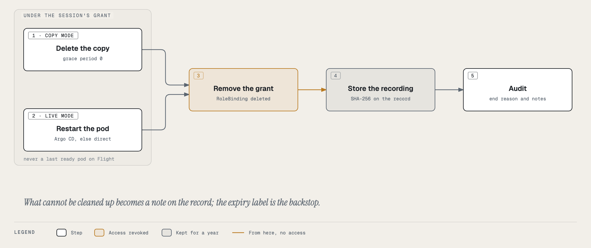

# Inside the session

## Your shell

The terminal runs `sh` in the debug container, as **user and group 65532**, in the Tower debug image
(`ghcr.io/jfillman/tower-debug`, Alpine-based, signed, pinned by digest). The prompt is `debug <dir> $`.

| Need | Tools |
|---|---|
| HTTP, TLS | `curl`, `openssl` |
| DNS | `dig`, `host`, `nslookup` |
| Sockets, routes, processes | `ss`, `ip`, `lsof`, `ps`, `top`, `nc` |
| Data | `jq`, `less` |
| Databases | `psql` (PostgreSQL 17 client), `redis-cli` |
| Everything else | busybox: `ls`, `cat`, `grep`, `sed`, `awk`, `find`, `vi`, `wget`, `tar`, … |

**Not included, on purpose:** `ping`, `traceroute`, `tcpdump`, `strace`, `gdb`. They need Linux capabilities
(`NET_RAW`, `NET_ADMIN`, `SYS_PTRACE`) that every debug container has dropped. Use `nc -zv host port` or
`curl -v` to test reachability instead of `ping`.

## What you can and cannot do

| You can | You cannot |
|---|---|
| read anything the debug container can see | write anywhere: the root filesystem is read-only, and `/tmp` and `$HOME` are part of it |
| connect out from the pod's network, as the pod would | gain privileges: no root, no `sudo`, no capabilities, no privilege escalation |
| read the app's volumes under `/pod-volumes/` (with volume access) | write to the app's volumes: every mount is read-only |
| see the app's processes (live pod, with process access) | read another user's `/proc/<pid>/` files or environment |
| run the clients above against the app's dependencies | call the Kubernetes API as the app: the debug container has no ServiceAccount token |
| resize the terminal | install packages (read-only filesystem, and no root) |

Shell history and client history files (`psql`, `redis-cli`, `less`) go to `/dev/null`. The recording is the history.

## Useful starting points

```sh
ps -o pid,user,args              # processes (live pod, process access): who runs as which user
ss -tnp                          # TCP connections and their state
dig +short <service>.<namespace>.svc.cluster.local
nc -zv <host> <port>             # can the pod reach it?
curl -sv https://<host>/ -o /dev/null   # TLS handshake and certificate
openssl s_client -connect <host>:443 -servername <host> </dev/null | openssl x509 -noout -dates
ls /pod-volumes/                 # volumes (volume access)
psql "host=<db> user=<user> dbname=<db>"   # with the credentials the app mounts
redis-cli -h <host> ping
```

## The banner and the clock

- The red **● Recorded break-glass session** banner is always on screen, with the mode, the options, and the time left.
- **Extend +15 min** adds 15 minutes, once. The countdown then says *(extended)*.
- **End session** ends it now.
- In live mode a line under the banner reminds you that the pod will be restarted when you end.
- With volume access the mounted volumes are listed under the banner.

## Disconnects and other tabs

- Closing the terminal (or losing the network) does not end the session at once. You have **2 minutes** to press
  **Reconnect** or **Reopen terminal**. After that it ends and cleans up.
- Opening the same session in a second tab moves the terminal there; the first tab is told *opened in another tab*.
- Only the requester can attach. An approver or an admin can end a session, but not watch it live; the recording is
  how anyone else sees it.

## Everything is recorded

Every keystroke you send, everything the shell prints, and every terminal resize is written to an
[asciicast v2](https://docs.asciinema.org/manual/asciicast/v2/) recording with timestamps. It is saved at least once a
minute while you work and again when the session ends, with its SHA-256 on the session record. A session whose
recording passes 64 MB ends (*recording size limit reached*). See [Recordings](recordings.md).

Do not paste secrets into the terminal. What you type is in the recording for a year.

## How a session ends

| End reason on the record | Cause |
|---|---|
| *ended by user* | you pressed End session |
| *shell exited* | you typed `exit`, or the shell died |
| *expired* | the session's time ran out |
| *idle for 10 minutes* | no input or output for 10 minutes |
| *terminal closed and not reopened within 2 minutes* | you closed the tab or lost the network |
| *pod is gone* | the pod you were in was deleted (a rollout, a scale-down) |
| *terminated by <user>* | an admin or the approver ended it |
| *recording size limit reached* | the recording passed 64 MB |
| *backend restarted during the session* | Backstage restarted; the recording is the last checkpoint |
| *failed to start: …* | the session never opened; the message says why (see [Troubleshooting](troubleshooting.md)) |

Whatever the reason, the cleanup is the same:



1. **Copy pod deleted** (copy mode), while the grant still allows it.
2. **Live pod restarted** (live mode): through Argo CD, as Tower's *Restart pod* does; or deleted directly when Argo CD
   does not manage it (an attached component such as Redis). Not a last ready pod on Flight, nor on Ground unless you
   ticked the box; you are notified instead.
3. **Grant removed**: the temporary RoleBinding that gave Backstage the debug role in the namespace.
4. **Recording stored** with its SHA-256.
5. **Audited**, with the end reason, what was cleaned up, and the recording's hash.

Anything that could not be cleaned up is listed as **notes** on the record. The grant and the copy pod also carry an
expiry label (the session's length plus 15 minutes): on Ground the cluster deletes them at that time even if Backstage
never does. On Flight that cluster-side backstop is being added; until then, a Backstage that restarts ends and cleans
up every session the old process left behind within 15 seconds.
