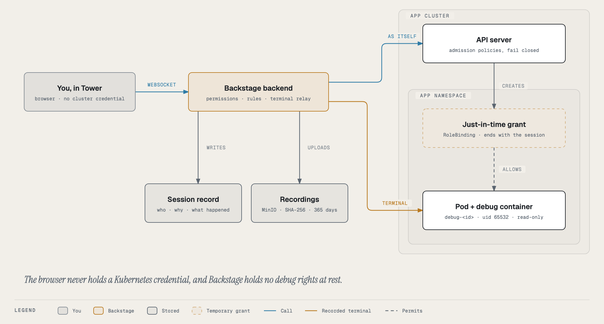

# Break-glass debugging

Sometimes logs, metrics, events and the resource tree are not enough. You need to look **inside** a running pod: list
its processes, resolve a name from its network, open a connection it holds, read a file it wrote. Break-glass gives you
that: a **recorded, time-boxed shell in a hardened debug container**, opened from Tower, on one pod of your own app.

You never get `kubectl exec`, and you never hold a Kubernetes credential. Tower's backend opens the session for you,
watches it, records every byte, and cleans up when it ends.

## When to use it, and when not to

| Use break-glass to… | Don't use it to… |
|---|---|
| see which processes are running and what they hold open | fix a problem by changing the running pod (that is a release, a rollback or a config PR) |
| test DNS, TCP or TLS from inside the pod's network | poke around Ground "just to look" when a log line would answer it |
| read a config file or a mounted Secret the app actually received | copy data out of production |
| check what a database or Redis looks like from the app's side | anything a metric, a log or the Topology tab already shows |

Every session is audited and its recording is kept for a year. On Flight a second person approves it first. Treat it
the way you would treat a page to a colleague: worth it when you need it.

## Ground and Flight

What happens when you press **Debug** depends on the environment's tier.

| | Ground (dev, PR previews) | Flight (staging, production) |
|---|---|---|
| Who may open a session | the app's owners | the app's owners, **after a second person approves** |
| Who approves | nobody (opens at once) | an owner of the app **other than you**, or an admin |
| Without a second person | n/a | an admin may **break the glass**: start at once, announced to everyone, reviewed afterwards |
| Restart a last ready pod at the end | if you tick the box | never; it keeps the debug container until the next rollout |
| Audit severity | high | medium for the request, high when it opens, critical if the glass was broken |

How Tower decides the tier (the request never says):

1. A **PR preview** namespace (labelled `hangar.io/ephemeral-env: "true"`) is Ground.
2. Otherwise the app's `cicd.yaml` decides, read on the server: an environment it declares as Ground (in
   `deploy.environments`, or the older `lowerEnvironments`) is Ground, one it declares as Flight is Flight. This is the
   same tier the [Environments](../environments.md) tab shows.
3. An environment `cicd.yaml` does not name (an **infra service** such as skyport-auth has no `cicd.yaml` at all) takes
   its cluster's tier: the dev cluster is Ground, every other cluster is Flight.

## The life of a session

- **Requested** (Flight): waiting for a second person. Expires after **30 minutes** if nobody decides.
- **Approved** (Flight): you have **10 minutes** to press Start. The session's own clock starts then.
- **Active**: the debug container is running and the recording is on. It lasts 15, 30 or 60 minutes, plus **one free
  15-minute extension** if you need it.
- **Ended**: by you, by the clock, after 10 idle minutes, 2 minutes after you close the terminal without reopening it,
  when the shell exits, or by an admin or the approver. Tower removes the grant and the debug container, restarts the
  pod if needed, and stores the recording.
- **Review due** (glass broken only): until someone who could have approved it, or a fallback reviewer, watches the
  recording and signs it off. Reviewers are reminded after a day and the admins alerted after three.

You can hold **one** open request or session at a time, across all apps.

## Where to find things

- **A pod's Debug panel** (Topology, the environment, Pods, a pod, **Debug**): the form to open a session on that pod,
  and the environment's sessions under it.
- **The Break-glass card** under Pods in Topology: the environment's sessions without choosing a pod. A live session
  restarts its pod and a copy is deleted at the end, so this is where a finished session (and its review) lives.
  Approvals, reviews, play and download are here; a badge counts what needs you.
- **The Break-glass strip** on the Tower home page and the Ops Wall: across every app, the requests you can decide,
  your approved request waiting for its Start, and the reviews you can do. It is empty, and hidden, most of the time.
- **Notifications** link straight to the session they are about.

## Guides

| Read this | When you want to… |
|---|---|
| [Walkthrough: a Ground session](ground-walkthrough.md) | debug a dev or preview pod, start to finish |
| [Walkthrough: a Flight session](flight-walkthrough.md) | request a production session, or approve someone else's |
| [Choosing a mode and options](options.md) | decide between a copy and the live pod, and what process and volume access mean |
| [Inside the session](in-the-session.md) | know what tools you have, where files are, what you cannot do, how it ends |
| [Breaking the glass and reviews](glass-broken.md) | open a Flight session with no second person (admins), or review one |
| [Recordings](recordings.md) | play, download or verify a recording, and know how long it is kept |
| [Guardrails](guardrails.md) | understand every protection, and what each one stops |
| [Troubleshooting](troubleshooting.md) | understand a message Tower showed you |

Running the platform? The [admin guide](admin/index.md) covers setup, configuration, the admission policies,
operations and internals.
