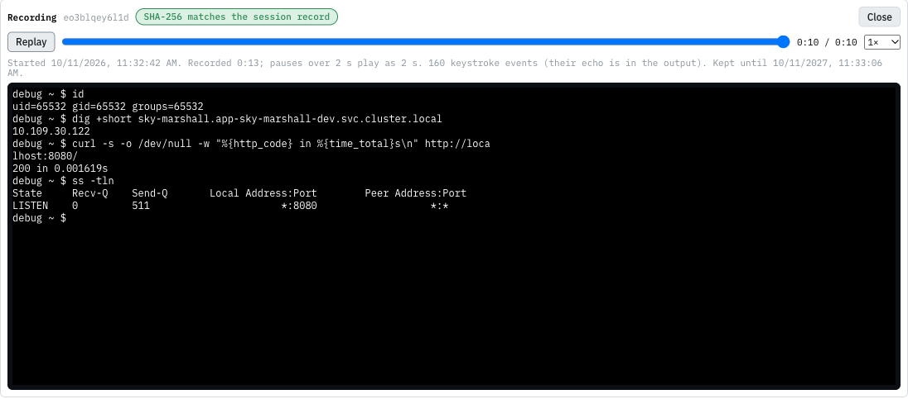

# Recordings

Every break-glass session is recorded: every keystroke sent, everything printed, and every terminal resize, with
timestamps. A session cannot start if recordings are not configured.

## Who can see a recording

The app's **owners** and the **admins**. Every play and every download is audited, with who and which session.

A **sensitive** session (volume or process access: it could read Secrets) narrows that to **admins, the approver, the
reviewer** (while a glass-broken review is due, anyone who could review it) **and the requester**. Other owners see
the session record, not the recording, with a message saying why; a play of a sensitive recording is audited *high*.
The recording is not redacted: the backend never reads the Secrets (it has no `get secrets`), so it cannot know what to
mask, and pattern-masking would give false comfort.

## Playing a recording

In Topology, the environment's **Break-glass** card under Pods (or any pod's Debug panel) lists the sessions; find
yours and press **play**. The recording opens under the list:

| Control | What it does |
|---|---|
| **Play** / **Pause** / **Replay** | start, pause, or start again from the beginning |
| seek bar | jump to any point; the screen is redrawn exactly as it was then |
| speed | 0.5×, 1×, 2×, 4× or 8× |
| **Close** | close the player |

The replay runs in the same terminal as a live session, so it looks exactly as the session did, colours and all.

- **Pauses are shortened.** A gap of more than 2 seconds plays as 2 seconds, so someone reading a page of output does
  not make you wait. The line under the controls shows the real length (*Recorded 4:12*) next to the playback length.
- **Keystrokes are counted, not replayed.** The shell echoes what was typed, so it is already in the output. The line
  under the controls says how many keystroke events the recording holds.
- **The start time** and **how long the recording is kept** are shown under the controls.

## Is this the real recording?

When a session ends, Backstage stores the recording's **SHA-256** on the session record. The player downloads the
recording, hashes it in your browser, and compares:

| The player shows | Meaning |
|---|---|
| **SHA-256 matches the session record** | the recording is byte-for-byte the one stored when the session ended |
| **SHA-256 does not match the session record** | the file differs from what the session stored: treat it as tampered with, and tell an admin |
| **integrity not checked** | your browser could not hash it (Tower is not on `https` or `localhost`), or the session has no stored hash |

## Is the store itself trustworthy?

Two things make a recording hard to rewrite after the fact, on top of the SHA-256 check:

- **The bucket is object-locked.** Every recording (and every checkpoint while the session runs) is a new *version*
  in a versioned bucket with a 365-day retention in governance mode: a version cannot be deleted or replaced for a
  year, not even by the store's root user without a special bypass right nobody holds day to day. The session record
  names the exact version the SHA-256 is about.
- **The hash is anchored in the platform's transparency log.** When the session ends, Backstage signs the recording's
  SHA-256 with its anchor key and submits it to Rekor; the session record keeps the log index, and the player shows
  **anchored in Rekor #N**. Anyone can check it without Backstage: `rekor-cli get --log-index N` returns the hash to
  compare with the file. If Rekor was unreachable when the session ended, the record says **not anchored** and the
  backend keeps trying for a day.

Neither depends on the other: the lock stops a replacement, the log proves what the recording was even if both the
bucket and the database were later altered by someone with bypass rights.

## Downloading

**download** saves the recording as `breakglass-<app>-<env>-<id>.cast`. A `.cast` file is a plain-text
[asciicast v2](https://docs.asciinema.org/manual/asciicast/v2/) file:

- the first line is a JSON header: terminal size, start time, and a title naming the mode, the app, the environment,
  the pod, the requester and the approver (or *glass broken*);
- every other line is one event: `[seconds, "o" | "i" | "r", data]` (output, input, resize).

To play it outside Tower, use [asciinema](https://asciinema.org/) (`asciinema play breakglass-….cast`). To check it
against the record, compare `shasum -a 256 breakglass-….cast` with the SHA-256 shown when you hover **download**, and
against the transparency log with `rekor-cli get --log-index <N>` (the number next to **anchored**).

## How long recordings are kept

**365 days** from the end of the session. Then the storage deletes the recording; the session record stays, with its
hash, its times and its end reason, but **play** and **download** answer *the recording was deleted on <date>, after
the 365-day retention*. Hover **download** to see the date for a session; the player shows it too.

## When a recording is incomplete

| The record says | Why |
|---|---|
| *nothing was recorded: no terminal was opened* | the session was started but nobody attached a terminal |
| *recording is the last checkpoint before the backend restarted* | Backstage restarted mid-session; up to a minute at the end is missing |
| *no recording: the backend restarted before the first checkpoint* | Backstage restarted in the session's first minute |
| *recording upload failed: …* | the storage was unreachable at the end; tell an admin |
